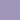
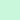
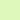
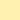

# nekozame-theme

Soft violet-gray with pastel pink, baby blue, mint, lemon and lilac. The theme of [nekozame os](https://github.com/purplekairi1312/nekozame-os).

<!-- palette -->
| | Name | Hex | Used for |
|---|---|---|---|
|  | Crowning | `#5a4f6e` | background |
|  | Roman Purple | `#4f4562` | sidebars, popups, title bars |
|  | Purple Velvet | `#433a55` | borders, terminal black, text on pink |
|  | Napa Winery | `#685c7f` | raised elements, inactive tabs |
|  | Grape Parfait | `#8a76a8` | selected items |
|  | Queen’s | `#7c6a9a` | selected text in editors |
|  | Lush Mauve | `#a094b8` | line numbers |
|  | Wisteria-Wise | `#b3a7cb` | disabled and inactive text |
|  | White | `#ffffff` | text |
|  | Sweet Sachet | `#ffd9ef` | pink text (terminals) |
|  | Lingering Lilac | `#e8def5` | secondary text |
|  | Italian Fitch | `#d8cdec` | code comments |
|  | Minute Mauve | `#f1e6ff` | operators, variables |
|  | Pretty in Pink | `#ffc0e5` | main accent: cursor, focus, titles |
|  | Little Smile | `#ffd4ee` | soft accent, headings |
|  | Garden Glory | `#ffc0d2` | warm accent |
|  | Rosy Maple Moth | `#ffc6ea` | links |
|  | Baby Pink | `#ffb3c8` | errors |
|  | Classic Rose | `#ffd1ec` | focused borders, dividers |
|  | Lens Flare Pink | `#e3ccff` | keywords |
|  | Arctic Paradise | `#b8e4ff` | functions, info |
|  | Ice Citadel | `#b8f5f2` | types, special |
|  | Out of Blue | `#c8f7dc` | strings, success |
|  | Chicon | `#dcf8bc` | additions |
|  | Thunderbolt | `#fff1b0` | warnings, numbers |
|  | Peachy Bon-Bon | `#ffd2b8` | constants |
<!-- /palette -->

All of it is in [`palette.toml`](palette.toml).

## Install

Everything is in [`themes/`](themes).

| App | File | Where |
|---|---|---|
| Doom Emacs | `emacs/nekozame-theme.el` | `~/.config/doom/themes/`, then `(setq doom-theme 'nekozame)` |
| Ghostty | `ghostty/nekozame` | `~/.config/ghostty/themes/`, then `theme = nekozame` |
| KDE Plasma | `kde/nekozame.colors` | `~/.local/share/color-schemes/`, then System Settings → Colors |
| Konsole | `konsole/nekozame.colorscheme` | `~/.local/share/konsole/` |
| VS Code | `vscode/` | copy the folder to `~/.vscode/extensions/purplekairi1312.nekozame-1.0.0` |
| btop | `btop/nekozame.theme` | `~/.config/btop/themes/`, then `color_theme = "nekozame"` |
| Starship | `starship/starship.toml` | `~/.config/starship.toml` (a full prompt config) |
| Zen Browser | `zen/userChrome.css` | `chrome/` in your profile, with `toolkit.legacyUserProfileCustomizations.stylesheets` on |
| Discord | `discord/nekozame.theme.css` | Vencord's themes folder |
| Bitwig Studio | `bitwig/nekozame_bitwig_6.1.4.bte` | load it with the [Bitwig Theme Editor](https://github.com/Berikai/bitwig-theme-editor) |
| Krita, GIMP, Aseprite | `palettes/nekozame.gpl` | the app's palettes folder |

## Changing colors

Edit [`palette.toml`](palette.toml), run `./name-colors.py` if you changed a hex (it names the color), then `./generate.py`. Every theme in `themes/` is rebuilt from [`templates/`](templates), so they all stay the same. Bitwig's file is the exception: its shades are tuned by hand.

## License

[CC BY-NC-SA 4.0](LICENSE).
