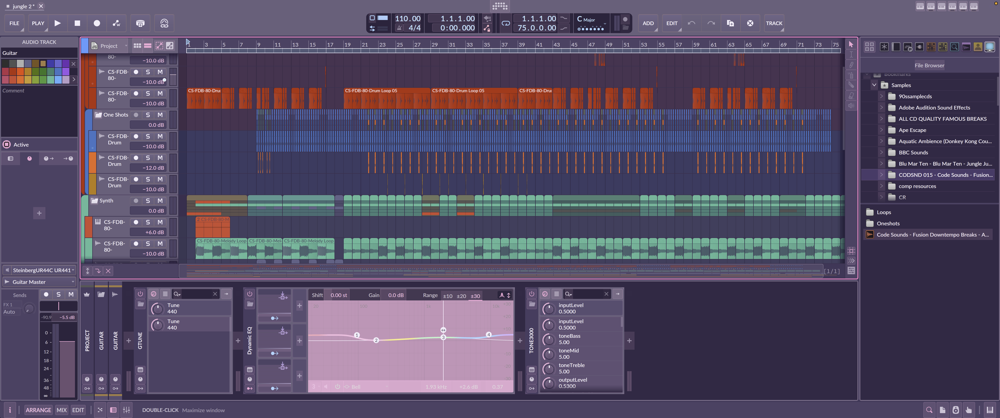

# nekozame for Bitwig Studio

The [nekozame](https://github.com/purplekairi1312/nekozame-theme) theme for Bitwig: soft violet-gray with pastel pink, baby blue, mint, lemon and lilac. For the latest Bitwig (6.1.7).

## Install

1. Download [`nekozame.bte`](https://raw.githubusercontent.com/purplekairi1312/nekozame-theme/main/themes/bitwig/nekozame.bte), get the [Bitwig Theme Editor](https://github.com/Berikai/bitwig-theme-editor) and quit Bitwig.
2. Open the editor and point it at Bitwig's `bitwig.jar`:
   - macOS: `/Applications/Bitwig Studio.app/Contents/Java/bitwig.jar`
   - Linux: `/opt/bitwig-studio/bin/bitwig.jar`, or for the Flatpak `/var/lib/flatpak/app/com.bitwig.BitwigStudio/current/active/files/bin/bitwig.jar` (both need admin rights to patch)
   - Microsoft Windows: in `C:\Program Files\Bitwig Studio\`, under `bin\` (search the folder for `bitwig.jar` if your version keeps it elsewhere)
3. Load `nekozame.bte` and apply it, then start Bitwig.

Bitwig updates replace its jar, so apply it again after updating.

## License

[CC BY-NC-SA 4.0](../../LICENSE).
